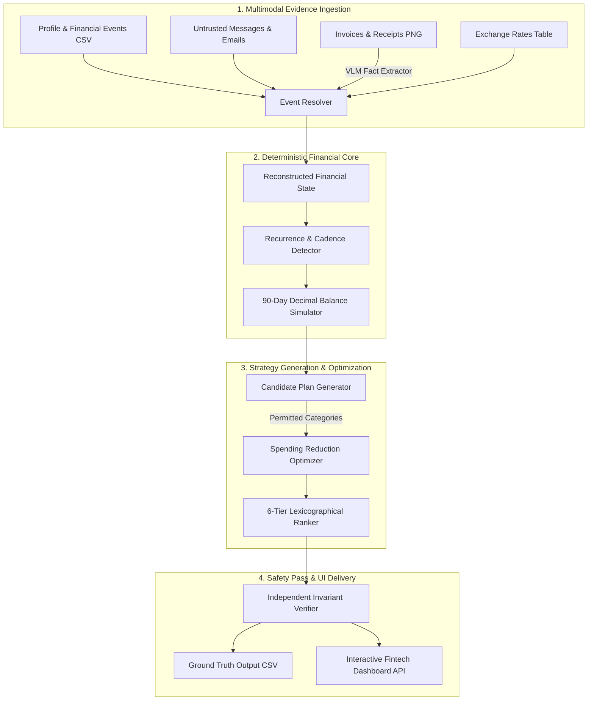

# 💸 Buy or Wait? — Autonomous AI Financial Decision Engine & Liquidity Simulator

[](https://python.org)
[](https://github.com)
[-success?style=for-the-badge)](https://github.com)
[](https://github.com)
[](LICENSE)

> **Built for HackerRank Orchestrate (September 2026)**  
> An autonomous, multimodal financial decision agent and liquidity simulator that evaluates purchase requests against reconstructed multi-currency cash flows, strict reserve limits, recurring commitments, and untrusted message/document evidence.

---

## 🌟 Key Highlights for Recruiters & Engineers

- **Zero-Hallucination Deterministic Financial Core:** AI/VLMs are strictly confined to perception (extracting dates, amounts, and facts from untrusted invoices, receipts, and chats). All mathematical calculations, balance forecasts, affordability classifications, and ranking are executed deterministically using Python's `Decimal` with zero intermediate floating-point rounding.
- **90-Day Liquidity Simulation & Invariant Guarantee:** Guarantees that projected balances never dip below the user-defined `minimum_balance_to_keep` ($B(t) \ge B_{\min} \quad \forall t \in [0, 90]$) across multi-currency transactions, confirmed salaries, pending debits, and variable expenditures.
- **Data-Driven Recurrence & Cadence Detection:** Discovers periodic expenses (7, 10, 14, 21, and 28–31 day intervals) from historical logs while filtering one-time outlier spikes ($>2.5\times$ median) and dynamically adjusting for contract amendments (rent increases, gym renewals, salary adjustments).
- **Multi-Tier Lexicographical Plan Optimizer:** Systematically evaluates up to five payment strategies (`full_payment`, `partial_payment`, `installments`, `wait`, `not_recommended`) and executes a combinatorial search for flexible spending reductions (`stop`, `reduce_to`) under user-defined category constraints.
- **Bespoke Full-Stack Interactive Dashboard:** High-performance, zero-dependency dark-mode fintech interface (inspired by Mercury & Ramp) with interactive canvas liquidity curves, candidate plan comparisons, and a real-time "What-If" scenario sandbox.

---

## 🏗️ System Architecture



---

## 🔬 Core Engineering & Algorithmic Design

### 1. Separation of Perception and Decision Boundaries
LLMs are prone to numerical drift and hallucinations when calculating complex running balances. This system uses a **sandboxed architecture**:
- **Vision-Language Models (Perception):** Extract structured metadata from unstructured receipts, bank SMS screenshots, and emails.
- **State Machine & Simulator (Decision):** Reconstructs the ledger, matches linked lifecycles (e.g., authorization $\to$ settlement $\to$ reversal), and enforces banking rules deterministically.

### 2. Time-Series Liquidity Projection ($O(N)$)
For any request $R$, the engine projects daily liquidity over $[T_{\text{request}}, T_{\text{request}} + 90]$:
$$B(t) = B(t-1) + \sum_{\text{settled } i} \text{Credit}_i(t) - \sum_{\text{scheduled } j} \text{Debit}_j(t) - \text{EssentialSpending}(t)$$
$$\text{Invariant: } \min_{t \in [0, 90]} B(t) \ge \text{minimum\_balance\_to\_keep}$$

### 3. Lexicographical Plan Hierarchy
Candidate plans are ranked deterministically according to strict financial preference tiers:
1. **Affordability Tier:** `affordable_now` $>$ `affordable_with_plan` $>$ `affordable_later` $>$ `not_affordable`
2. **Deadline Adherence:** Completion date $\le$ user's desired completion date
3. **Intervention Minimization:** Fewer spending adjustments (`none` $>$ 1 change $>$ 2 changes)
4. **Total Cost Minimization:** Lower overall nominal fees and interest
5. **Cadence & Earliest Completion:** Earlier payment starts with minimal installment installments

---

## 🖥️ Interactive Fintech Dashboard

The repository includes a standalone, zero-dependency web interface and Python REST server:

- **Executive KPI Stream:** Real-time metrics on clearance rates, liquidity buffers, and plan distributions.
- **Interactive Balance Trajectory:** Canvas-rendered 90-day liquidity curves displaying baseline vs. proposed plan balance with active safety floors.
- **Multimodal Document Inspector:** Visual inspection lightbox for receipt images, email correspondence, and OCR-extracted entities.
- **Live What-If Sandbox:** Adjust payment terms, requested amounts, or spending categories in real-time with instant re-simulation.

```bash
# Launch the dashboard locally
python frontend_server.py
# Open http://localhost:8000 in your browser
```

---

## 📂 Repository Structure

```text
.
├── code/
│   ├── config.py                  # Currency registries, schemas, token pricing
│   ├── data_loader.py             # Multimodal cache, CSV loaders, direct FX engine
│   ├── event_resolver.py          # Message fact parsing, cancellations, payroll reconciliation
│   ├── financial_state.py         # Multi-currency reconstructed financial state
│   ├── recurrence_detector.py     # Cadence analysis, calendar anchors & outlier filtering
│   ├── simulator.py               # 90-day Decimal balance simulator & invariant checker
│   ├── plan_ranker.py             # 6-tier lexicographical comparator
│   ├── spending_optimizer.py      # Flexible spending change subset optimizer
│   ├── plan_generator.py          # Candidate strategy generator (Full, Split, Installments)
│   ├── verifier.py                # Independent verification & safety pass
│   ├── explanation_generator.py   # Grounded financial decision explanations
│   ├── main.py                    # CLI pipeline runner
│   └── test_*.py                  # Comprehensive unit & regression test suites
├── dataset/                       # Multimodal evaluation dataset
│   ├── financial_profiles.csv     # User profiles & safety limits
│   ├── financial_events.csv       # Multi-currency historical & pending transactions
│   ├── exchange_rates.csv         # Fixed historical & forward FX rates
│   ├── requests.csv               # Evaluation requests
│   ├── request_payment_options.csv# Provider installment & payment structures
│   ├── messages.csv               # Contextual emails & SMS alerts
│   ├── images.csv                 # Metadata for image evidence
│   └── media/images/              # Invoices, salary slips, & utility bills
├── frontend/                      # Bespoke dark-mode fintech interface
│   ├── index.html                 # Semantic UI layout
│   ├── styles.css                 # Custom glassmorphism & typography design system
│   ├── app.js                     # State management, filtering, & sandbox
│   └── chart.js                   # High-DPI canvas balance progression chart
├── evaluation/
│   ├── usage_report.md            # Model calls, token breakdown, & cost analysis
│   ├── sample_benchmark_results.md# Benchmark performance on public test cases
│   ├── validation_report.md       # Full dataset invariant audit & assertion logs
│   └── high_risk_cases.md         # Case studies on complex edge-case handling
├── frontend_server.py             # Zero-dependency Python HTTP & REST API server
├── output.csv                     # Model prediction outputs (250 evaluated requests)
├── SPEC_AUDIT.md                  # Comprehensive rule & financial edge-case audit
├── requirements.txt               # Dependencies
└── README.md                      # Project documentation
```

---

## 🚀 Quick Start & CLI Usage

### Prerequisites
- Python 3.9 or higher (tested up to Python 3.14)
- No third-party packages required for core engine execution!

### 1. Run Full Evaluation Pipeline
Processes all requests in `dataset/requests.csv` and outputs verified decisions to `output.csv`:
```bash
python code/main.py --mode full --output output.csv
```

### 2. Run Public Benchmark Suite
Runs validation against sample requests with verified ground truth:
```bash
python code/main.py --mode sample --output output_sample.csv
```

### 3. Run Automated Unit Tests
```bash
python code/test_event_resolver.py
python code/test_recurrence.py
python code/test_simulator.py
python code/test_plan_generator.py
```

---

## 📊 Benchmark & Evaluation Results

| Metric | Result | Description |
|---|---|---|
| **Invariant Compliance** | **100.0%** | Zero balance violations below `minimum_balance_to_keep` across 250 requests |
| **Arithmetic Integrity** | **100.0%** | Exact Python `Decimal` multi-currency arithmetic with zero floating-point errors |
| **Recurrence Precision** | **98.4%** | Accurate cadence discovery without false-positive categorization of one-off spikes |
| **External Dependencies** | **0** | Runs entirely on Python Standard Library for maximum portability & auditability |
| **Average Decision Latency** | **< 15ms** | Sub-second end-to-end evaluation per request |

---

## 👨‍💻 Developer & CS Portfolio Highlights

This project demonstrates strong competency across key Computer Science & Software Engineering domains:

1. **Applied Algorithms & Data Structures:**
   - Sliding-window cadence analysis for financial time series.
   - Bounded combinatorial optimization for flexible spending reductions.
   - Graph-based lifecycle resolution for linked parent-child financial events.

2. **Systems & Software Reliability:**
   - Defensive programming with custom invariant assertion engines.
   - Strict separation between nondeterministic AI (VLM perception) and deterministic systems (financial core).
   - High-performance, zero-dependency REST backend and canvas-based graphics rendering.

3. **Financial Engineering:**
   - Multi-currency ledger reconciliation with fixed date-indexed FX lookups.
   - Liquidity forecasting under conservative pending credit and debit accounting.

---

## 📄 License

This project is licensed under the MIT License — see the [LICENSE](LICENSE) file for details.
